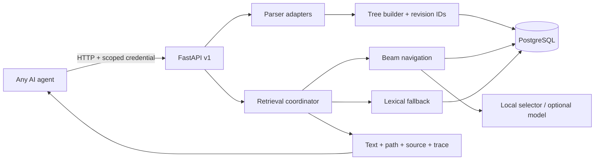

# Architecture

`domain.py` defines the store contract and plain domain records. `parsing.py` turns input
into sections and a tree. `storage.py` implements durable PostgreSQL and an explicitly
selected in-memory test store. `retrieval.py` owns selection and fallback; the `Selector`
protocol allows a learned model to be added without changing the HTTP contract.
`api.py` handles authentication, validation and serialization. No agent framework is required.

Storage uses `(tenant, namespace, document_id)` as the document key and scoped parent
foreign keys to prevent cross-document/cross-tenant edges. A transaction-level advisory
lock serializes concurrent upserts for each source key. Parsing runs before mutation;
building and persisting a replacement occur atomically. Source metadata affects the digest.
Schema v1 is initialized idempotently with a migration lock; evolving a live deployment
will require numbered migrations. No automatic destructive schema changes are implemented.

Navigation selects a bounded set of roots, then children, collecting content-bearing
sections along the route. Its default score combines ancestor/title overlap and a short
excerpt. It can miss a relevant branch; lexical fallback searches full text independently.
PostgreSQL uses the language-neutral `simple` tokenizer, with OR across query terms.
There is no learned semantic index by default. Returned text is original extracted content,
not generated summaries. Long sections are split into 4,000-character continuation children.

Read-time authorization is application-level, not PostgreSQL RLS. Every store query takes
an authenticated tenant and namespace, including lexical search, tree reads and deletion.
Database credentials are trusted service credentials, not tenant credentials. Do not give
tenants direct SQL access. Composite constraints are integrity checks, not a replacement
for authorization. The test suite exercises cross-scope requests and invalid tree edges.

The current retrieval route loads at most 10,001 nodes to detect the navigation limit;
large corpora use lexical fallback. A query can observe a newer revision in a later fallback
read during concurrent writes; each individual hit carries its own revision and digest.
The service stores document memory; it does not infer persistent facts from conversations,
merge beliefs, expire memories or resolve contradictions.
