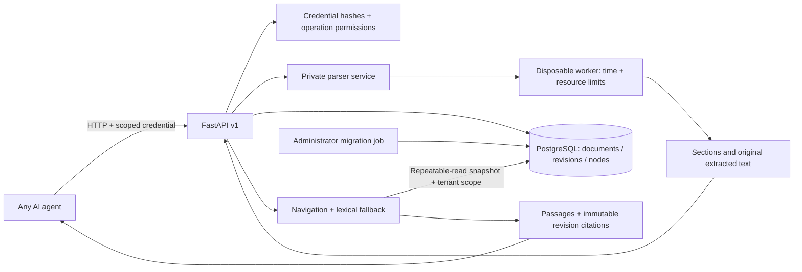

# Architecture — v0.2

`domain.py` defines records/store interfaces; `storage.py` implements PostgreSQL; `memory.py`
is explicitly test-only. `migrate.py` applies numbered SQL migrations atomically with an
advisory lock and SHA-256 checksums. It can adopt the existing v0.1 schema without changing
document IDs or losing the currently stored tree. `schema.sql` is retained solely as a
v0.1 upgrade-test fixture. Schema rollback is by backup restore, not destructive down scripts.

The logical ingestion key is `(tenant, namespace, source_key)`. A source-specific advisory
lock serializes upsert/delete operations. Each new document lifecycle has a fresh UUID;
updates preserve that ID and append a revision. Every revision has its own metadata and
nodes. Scoped foreign keys enforce parent/revision/document consistency. The runtime role
cannot update historical rows. A full DELETE cascades through all history; recreating a
source uses another UUID and cannot reassign an old citation to new evidence.

Read and write transactions set tenant and namespace using transaction-local PostgreSQL
settings. RLS policies on all three data tables deny access when those settings are missing.
The API checks its database role is neither owner, superuser nor BYPASSRLS. SQL predicates
remain explicit as a second application-level check. The scope-setting connection is a
trusted service capability: RLS does not protect against a fully compromised API process
or a trusted administrator deliberately choosing another scope. Never expose SQL credentials
to tenants. The pool resets transaction-local context on commit/rollback.

Retrieval uses one repeatable-read, read-only transaction for navigation and lexical fallback,
so a concurrent ingestion cannot mix revisions within one response. It still loads a bounded
tree and uses local title/extractive-summary matching by default. The optional model selector
can replace candidate selection; it cannot emit arbitrary executable operations. Unknown
IDs and model failures are validated and handled. PostgreSQL lexical scores are actual
`ts_rank_cd` values, not the test store's token-overlap approximation.

Compose runs parser HTTP separately on an internal network with no egress, credentials,
published port or persistent storage. Each parse creates a disposable subprocess with a
minimal environment, temporary directory, a ten-second wall deadline and Linux CPU/address
space/file-size limits. At most two workers run per parser process. The container adds
non-root execution, read-only filesystem, dropped capabilities and PID/memory limits.
Without `PARSER_URL`, a local disposable subprocess is used; it lacks container network and
filesystem isolation and is intended for development or trusted inputs.

The HTTP layer enforces explicit `read`, `write` and `delete` permissions, reloads hashed
credential files per request, bounds request bodies, returns cursor pages and adds request
IDs. Request logs contain route templates, status and duration, not queries, documents,
credentials or source metadata. Quotas are per credential and API process; use a gateway
for aggregate quotas across replicas. The API's readiness check verifies schema availability.
